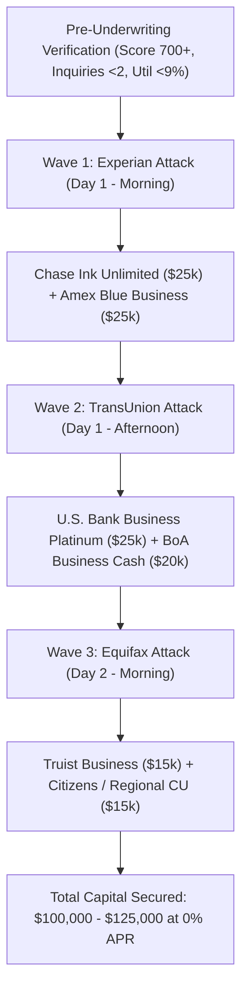

# 💳 0% APR CREDIT CARD STACKING SEQUENCING BLUEPRINT
**Credit 2 Money Solutions** | Proprietary Funding Architecture  
*The exact institutional procedure to obtain $50,000 to $150,000 in 0% business capital in 48 hours.*

---

## 1. The Core Philosophy of Credit Card Stacking
Credit card stacking is the strategic science of applying for multiple Tier-1 business credit cards simultaneously across different credit bureaus (Experian, TransUnion, Equifax) so that **no single bureau sees more than 1 or 2 inquiries at the time of underwriting**.

Because business credit cards (from Chase, Amex, US Bank, BoA, PNC, Truist) do NOT report to the owner's personal credit bureau (unless defaulted), **the consumer can deploy $100,000 in credit card capital at 0% interest with 0% personal credit utilization!**

---

## 2. The 3-Wave Execution Timeline

---

## 3. Step-by-Step Stacking Protocol

### Wave 1: The Experian Attack (Day 1 at 9:00 AM CST)
- **Target 1**: **Chase Ink Business Unlimited®** or **Ink Cash®**
  - Pulls: **Experian**
  - Why First: Chase has strict 5/24 rules and hates recent inquiries. Must be submitted first.
- **Target 2**: **American Express Blue Business Plus®**
  - Pulls: **Experian** (or Soft Pull if client has existing Amex personal card).
  - Strategy: Open Amex application in a private window 5 minutes after Chase.

### Wave 2: The TransUnion Attack (Day 1 at 2:00 PM CST)
- **Target 1**: **U.S. Bank Business Platinum**
  - Pulls: **TransUnion**
  - Why US Bank: US Bank offers an industry-leading **18 months at 0% APR**. They pull TransUnion in 90% of states, meaning the Chase and Amex inquiries on Experian are completely invisible to them!
- **Target 2**: **Bank of America Business Advantage**
  - Pulls: **TransUnion** (or Experian in some states).
  - Note: If client deposited $3,000-$5,000 in a BoA checking account 14 days earlier, automatic tier-1 approval triggers.

### Wave 3: The Equifax Attack (Day 2 at 10:00 AM CST)
- **Target 1**: **Truist Business Cash Rewards**
  - Pulls: **Equifax**
  - Equifax is untouched by Chase, Amex, and US Bank. Clean report with 0 inquiries equals rapid approval.
- **Target 2**: **Regional Credit Union or Citizens Bank**
  - Pulls: **Equifax**

---

## 4. Reconsideration & Underwriting Negotiation Scripts
If any application triggers a "Pending Review" or "7-10 Day Notice", **never wait for the letter in the mail**. Call the underwriting reconsideration desk within 24 hours:

### Script for Chase Lending Underwriting (888-270-2127):
> *"Hi, my name is [Antoine Solomon / Client Name], owner of [Business Name]. I recently submitted an application for the Ink Business Unlimited card (Reference #: [App #]). I'm calling to verify if there is any additional business documentation or verification needed from my side to help finalize the decision. We are expanding our business operations this quarter and projecting strong cash flow."*

### Key Rule for Reconsideration:
- Never say you are looking for cash or debt consolidation.
- Always state the capital is for **cash flow smoothing, inventory acquisition, marketing, or operating expenses**.
- If personal income is questioned, state total household gross income and verifiable revenue.
